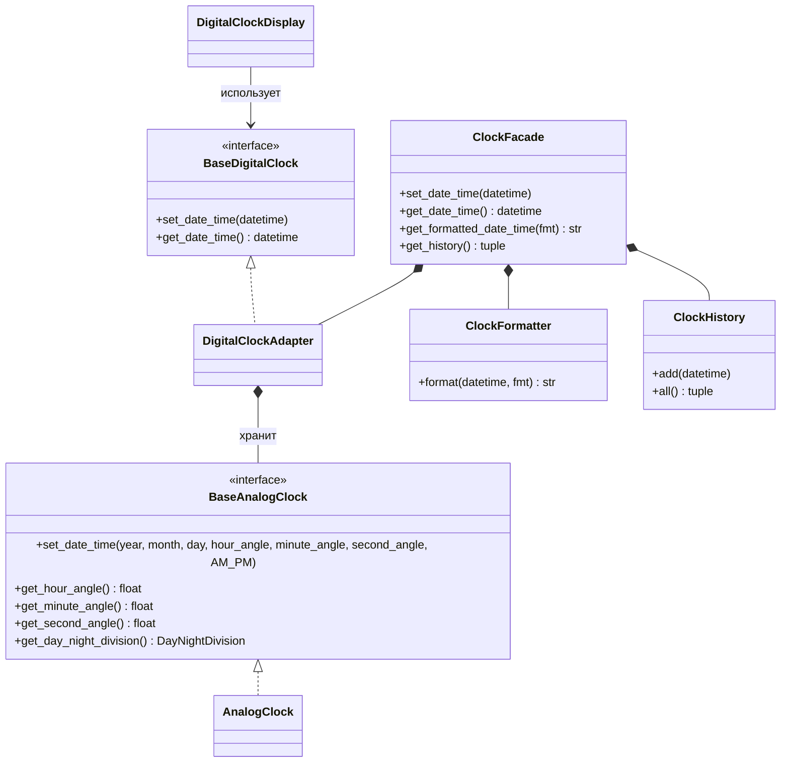

# Структурная диаграмма

`app.py` обращается только к `ClockFacade`. Отдельный клиент
`DigitalClockDisplay` может напрямую использовать `DigitalClockAdapter`, поскольку
тот реализует `BaseDigitalClock`.
